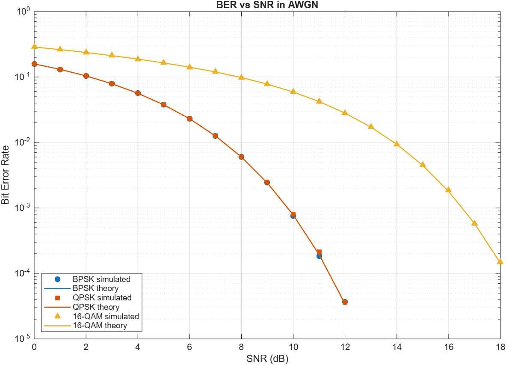

# Digital Modulation and Demodulation in Different Schemes

A C++ simulation of baseband **BPSK**, **QPSK** and **16-QAM** over an additive white Gaussian noise (AWGN) channel. For each scheme it measures the bit error rate (BER) across a range of signal-to-noise ratios (SNR) and checks the result against the exact theoretical BER.



Every simulated point lands on its theoretical curve. BPSK and QPSK overlap exactly, as theory predicts, and 16-QAM needs roughly 7 dB more SNR to reach the same BER, which is the cost of carrying 4 bits per symbol instead of 2.

## How it works

For each scheme and each SNR point, the simulation:

1. Generates 1,000,000 random bits.
2. Maps them to symbols (modulation).
3. Adds Gaussian noise scaled to the target SNR.
4. Recovers bits from the noisy symbols with hard decisions (demodulation).
5. Counts bit errors against the original bits to get the BER.

Results are printed as a table and written to `ber_bpsk.csv`, `ber_qpsk.csv` and `ber_16qam.csv`.

## Modulation schemes

All schemes use unit average symbol energy and Gray coding, so neighbouring constellation points differ by one bit.

| Scheme | Bits/symbol | Mapping | Decision rule |
|---|---|---|---|
| BPSK | 1 | 0 → +1, 1 → −1 | sign of the sample |
| QPSK | 2 | each bit drives one axis: 0 → +1/√2, 1 → −1/√2 | sign of I and of Q |
| 16-QAM | 4 | each axis is Gray 4-PAM: 00 → −3, 01 → −1, 11 → +1, 10 → +3, scaled by 1/√10 | sign gives the first bit; inside ±2 gives the second |

QPSK and 16-QAM symbols are complex. They are stored in a plain `double` array with I and Q interleaved (`I0, Q0, I1, Q1, …`), so every scheme shares the same function signatures.

## SNR definition

`add_noise()` sets the SNR as average power per stored sample divided by the noise variance per dimension. For these schemes that means:

| Scheme | SNR equals | Theoretical BER |
|---|---|---|
| BPSK | 2·Eb/N0 | Q(√SNR) |
| QPSK | Es/N0 = 2·Eb/N0 | Q(√SNR) |
| 16-QAM | Es/N0 = 4·Eb/N0 | ¼·[3Q(a) + 2Q(3a) − Q(5a)], a = √(SNR/5) |

Textbook curves are usually plotted against Eb/N0. To compare with those, subtract 3 dB from the SNR for BPSK and QPSK, and 6 dB for 16-QAM.

## Building and running

Requires a C++ compiler (tested with MinGW GCC 6.3 on Windows) and, for the plot, MATLAB.

```bash
g++ -std=c++17 -Wall *.cpp -o main.exe
./main.exe
```

In VS Code, the default build task (**Ctrl+Shift+B**) does the same. It expects MinGW at `C:\MinGW\bin`, so edit `.vscode/tasks.json` if yours is elsewhere.

To draw the plot from the CSVs:

```bash
matlab -batch "plot_ber"
```

This saves `ber_vs_snr.png`.

## Project structure

| File | Purpose |
|---|---|
| `main.cpp` | SNR sweep for each scheme, theoretical BER, table and CSV output |
| `modulation.hpp` | Modulation and demodulation declarations |
| `modulation_bpsk.cpp` | BPSK modulator and demodulator |
| `modulation_qpsk.cpp` | QPSK modulator and demodulator |
| `modulation_16QAM.cpp` | 16-QAM modulator and demodulator |
| `utils.hpp`, `utils.cpp` | AWGN noise, measured SNR and BER calculation |
| `plot_ber.m` | MATLAB script that plots all three BER curves |

## Note on reproducibility

On MinGW GCC 6.3, `std::random_device` is deterministic, so every run produces identical results. The statistics are still valid. On other compilers each run gives slightly different numbers.
